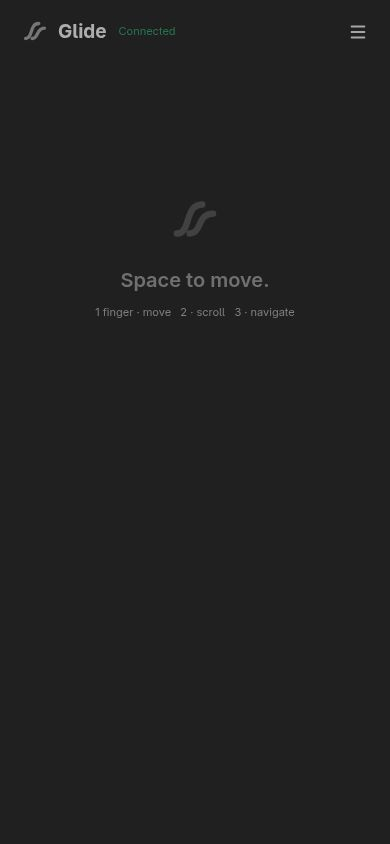
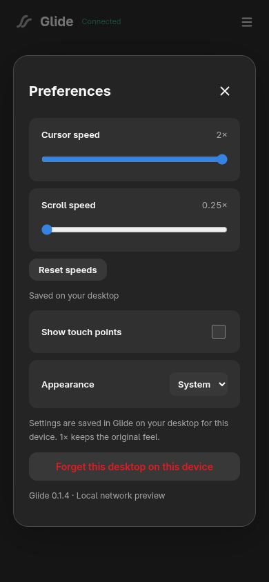

<p align="center"></p>
<h1 align="center">Glide</h1>
<p align="center"><strong>Your phone. Your touchpad.</strong><br>Turn a touchscreen into a native Linux touchpad, with smooth GNOME gestures.</p>
<p align="center"><a href="https://github.com/Stem-LG/Glide/releases/tag/v0.1.6">Download the AppImage</a> · <a href="#getting-started">Getting started</a> · <a href="#build-from-source">Build from source</a> · <a href="https://github.com/Stem-LG/Glide/issues">Report an issue</a></p>

Glide pairs a native **Rust + GTK4/libadwaita** desktop app with a lightweight web
controller. Open it on your phone or tablet, connect over your local network, and
use the whole screen to move, scroll, pinch, and navigate your desktop.

No phone app to install. No cloud service. No account.

> **Initial preview — v0.1.6.** The x86_64 AppImage is built and tested on
> **Fedora 44, GNOME 50, Wayland**. It is not a universal Linux binary: older
> distributions may need a source build. Use it only on a trusted local network;
> the current HTTP/WebSocket connection is not encrypted.

<p align="center"></p>

## Why Glide?

- **Native gestures:** a virtual multitouch device lets libinput and GNOME interpret
  your finger movement, including continuous three-finger navigation.
- **A full-screen touch surface:** unobtrusive branding, optional touch indicators,
  and a compact menu for fullscreen, preferences, disconnect, and reconnect.
- **Balanced movement:** the surface keeps its aspect ratio, with independent
  cursor and scroll speed controls from **0.25× to 2×**.
- **Settings that stay with your device:** speeds, appearance, and touch indicators
  are stored on the desktop and editable from either UI.
- **Simple pairing:** scan a locally generated QR code, then enter the desktop PIN.
- **At home on GNOME:** adaptive light/dark appearance, device management, background
  operation, a tray menu, and optional start at login.

## Getting started

### 1. Download and launch

Download `Glide-0.1.6-x86_64.AppImage` from the [release page](https://github.com/Stem-LG/Glide/releases/tag/v0.1.6).
Place it in a permanent location if you plan to enable **Start at login**, then:

```sh
chmod +x Glide-0.1.6-x86_64.AppImage
./Glide-0.1.6-x86_64.AppImage
```

If FUSE is unavailable:

```sh
./Glide-0.1.6-x86_64.AppImage --appimage-extract-and-run
```

The release includes `SHA256SUMS` to verify downloaded artifacts. It also includes
an inventory and a dependency source archive; these are useful for auditing or
rebuilding, and are not required to run Glide.

### 2. Allow virtual touchpad access

Glide needs write access to `/dev/uinput`. If the app reports that input is
unavailable, follow the [one-time input setup guide](data/setup/README.md).
The AppImage includes the same guide and rule in its `setup/` directory.

**Run Glide as your normal user, not with `sudo`.** Setup uses a dedicated group;
Glide does not change device permissions or firewall rules automatically.

### 3. Connect your phone

1. Put both devices on the same trusted network.
2. In Glide, choose **Show QR code**, then scan it with your camera. You can also
   type the displayed LAN address into your browser.
3. Enter the six-digit pairing code. Pairing closes automatically after success.
4. Use the top-right menu to enter fullscreen or open preferences.

To add another device, enable **Allow a new device** in the desktop app. Only one
device can control the touchpad at a time. **Forget device** revokes its pairing.

## Gestures and controls

| Touch | Action |
| --- | --- |
| One finger | Move the cursor |
| Tap | Click, when tap-to-click is enabled in desktop settings |
| Two fingers | Scroll; pinch where supported by the focused app |
| Three fingers | GNOME workspace/overview gestures |
| Top-right menu | Fullscreen, preferences, disconnect, reconnect |

Natural scrolling, tap-to-click, acceleration, and gesture availability also depend
on your desktop settings. Fullscreen support depends on the phone browser. The web
controller currently focuses on touch input; keyboard and media controls are not included.

### Per-device preferences

Open **Preferences** on the phone, or the **Device settings** button beside its name
in the desktop app. Changes sync while connected and are saved on the computer.
**1×** is the default speed; **Reset speeds** restores it for both controls.

A browser treats a new IP address or port as a different site. If the address changes,
enter the current desktop PIN and choose your existing device profile to restore its
settings. This replaces the profile's old pairing credential. Private browsing or
clearing browser storage also requires pairing again.

### Background operation

With **Run in background** enabled, closing the window keeps Glide running. Use
**Open Glide** in the tray menu to bring it back, or launch the AppImage again.
Use **Quit Glide** to stop it. **Start at login** is optional and defaults off.

GNOME needs a StatusNotifier/AppIndicator extension to display tray icons. Glide
also works without a tray host; launching it again reopens its window.

## Compatibility and troubleshooting

| Item | Current support |
| --- | --- |
| Packaged build | Linux x86_64; Fedora 44 build baseline |
| Verified desktop | GNOME 50 on Wayland |
| Controller | Modern touchscreen browser with Pointer Events and WebSockets |
| Input | `/dev/uinput`, interpreted by libinput |
| Other desktops/distributions | Not yet verified; source builds may work |
| Transport | HTTP/WebSocket on a trusted LAN, default port `8766` |

- **Cannot connect:** check the displayed IP, network isolation/guest Wi-Fi, and your
  firewall. Glide does not open ports for you. Restart it after changing networks.
- **Another device is connected:** disconnect it first; only one active controller
  is allowed.
- **Input unavailable:** check the [uinput setup](data/setup/README.md).
- **Missing tray icon:** check GNOME's AppIndicator support. You can always reopen
  Glide by launching the same AppImage.
- **Missing `GLIBC_*` or another host-library version:** this AppImage was built on
  Fedora 44. Build from source for your distribution; bundling GTK does not make
  the host libc portable.
- **New controls or movement fixes do not appear:** refresh the phone page after
  updating the desktop app.

Do not expose Glide's port to the Internet. Pairing tokens and input are currently
unencrypted in transit. See [SECURITY.md](SECURITY.md) for the security model.

## Build from source

On Fedora, install a current Rust toolchain and the native build dependencies:

```sh
sudo dnf install gcc pkgconf-pkg-config gtk4-devel libadwaita-devel
cargo build --locked --release
./target/release/glide
```

GTK **4.12+** and libadwaita **1.5+** are required. This release was built with Rust
1.97.1; use a current stable toolchain. Container packaging instructions are in
[docs/BUILDING.md](docs/BUILDING.md).

```sh
cargo fmt --check
cargo clippy --locked --all-targets -- -D warnings
cargo test --locked
# Python aiohttp required; isolated preview servers, no desktop input:
python3 tests/network.py target/release/glide
python3 tests/settings.py target/release/glide
```

Native input tests require `libinput debug-events`, uinput access, and permission to
read/grab their newly created test device. They exclusively grab that device so
the test gestures do not control your desktop:

```sh
python3 tests/native.py target/release/glide --speeds
python3 tests/full_sweep.py target/release/glide
python3 tests/axis_balance.py target/release/glide
```

### Configuration and CLI

Preferences and hashed pairing tokens live in `$XDG_CONFIG_HOME/glide/config.json`,
or `~/.config/glide/config.json`. `GLIDE_CONFIG_DIR` overrides that location for tests.
Do not share this file in issue reports.

| Flag | Purpose |
| --- | --- |
| `--background` | Start with the desktop window hidden |
| `--port 8766` | Choose the listening port |
| `--headless` | Run without GTK; print the pairing code in the terminal |
| `--preview` | Serve the controller without emitting desktop input |
| `--version` | Print the version |

## Contributing

Bug reports, testing on other distributions, and focused pull requests are welcome.
Include your desktop/session, distro, Glide version, phone browser, and steps to
reproduce. See [CONTRIBUTING.md](CONTRIBUTING.md) for development and testing notes.

## License and credits

Glide is licensed under **GNU GPL version 3 or later** (`GPL-3.0-or-later`).
See [LICENSE](LICENSE). Copyright © 2026 Glide contributors.

Inspired by [remote-touchpad](https://github.com/Unrud/remote-touchpad). Glide is an
independent Rust implementation; no upstream code was copied. It builds on GTK,
libadwaita, libinput, evdev, Axum, Tokio, ksni, and the wider Rust ecosystem.

Third-party components retain their own licenses. See
[THIRD_PARTY.md](THIRD_PARTY.md) and the inventories/source archive accompanying each
binary release.
